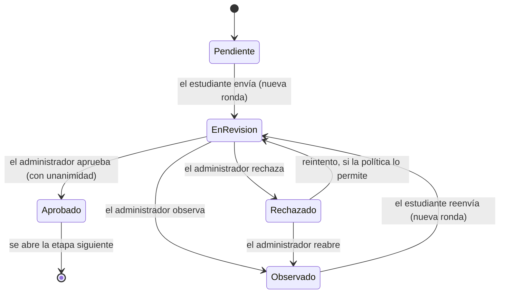

# Sistema de Gestión de Tesis (SGT) — Manual Técnico y de Arquitectura

> **Documentación elaborada por:** Sara Yulieth Quimbayo Osorio y Freyzzer Valencia.

| | |
|---|---|
| **Documento** | Manual Técnico y de Arquitectura |
| **Sistema** | Sistema de Gestión de Tesis de Grado (SGT-Tesis), servicio de backend (API) |
| **Dirigido a** | Ingenieros, desarrolladores, evaluadores y docente asesora |
| **Versión del documento** | 1.0 |
| **Fecha** | 21 de octubre de 2026 |
| **Rama de referencia** | `develop` |
| **Documento complementario** | [Manual de Usuario](MANUAL_DE_USUARIO.md) |

Este manual describe qué es el sistema, cómo está construido, por qué se tomaron las decisiones principales, cómo se verifica su calidad y qué falta para llevarlo a producción. Cada afirmación se apoya en el código, las pruebas o los documentos del repositorio (carpeta `docs/`), que se citan donde corresponde.

---

## Contenido

1. [Ficha técnica y stack tecnológico](#1-ficha-técnica-y-stack-tecnológico)
2. [Arquitectura de software](#2-arquitectura-de-software)
3. [Modelo de dominio y contextos delimitados](#3-modelo-de-dominio-y-contextos-delimitados)
4. [Persistencia, migraciones y esquema de base de datos](#4-persistencia-migraciones-y-esquema-de-base-de-datos)
5. [Proceso de etapas y reglas de negocio](#5-proceso-de-etapas-y-reglas-de-negocio)
6. [Contrato de la API](#6-contrato-de-la-api)
7. [Historias de usuario y criterios de aceptación](#7-historias-de-usuario-y-criterios-de-aceptación)
8. [Registro de decisiones de arquitectura (ADR)](#8-registro-de-decisiones-de-arquitectura-adr)
9. [Estrategia de pruebas y calidad](#9-estrategia-de-pruebas-y-calidad)
10. [Seguridad, auditoría y observabilidad](#10-seguridad-auditoría-y-observabilidad)
11. [Guía de despliegue y mantenimiento](#11-guía-de-despliegue-y-mantenimiento)
12. [Matriz de pendientes y brechas](#12-matriz-de-pendientes-y-brechas)
13. [Referencias dentro del repositorio](#13-referencias-dentro-del-repositorio)

---

## 1. Ficha técnica y stack tecnológico

### 1.1 Ficha

| Aspecto | Valor |
|---|---|
| Tipo de sistema | API REST (`/api/v1`) para la gestión del trabajo de grado |
| Lenguaje y plataforma | C# sobre **.NET 10** (`net10.0`) |
| Estilo de API | *Minimal APIs* de ASP.NET Core |
| Base de datos | **SQL Server 2022** (también compatible con 2019 o superior) |
| Acceso a datos | Entity Framework Core 10 con migraciones |
| Autenticación | JWT (HS256) de corta vida y *refresh tokens* rotados |
| Validación | FluentValidation 12 |
| Correo | MailKit (SMTP con STARTTLS) mediante un *outbox* transaccional |
| Registro de eventos | Serilog |
| Contenedores | Docker (imagen multietapa, usuario sin privilegios) y Docker Compose |
| Integración continua | GitHub Actions |
| Cliente web | Aplicación Angular 21 en un repositorio aparte (`sgt-tesis-frontend`) |

### 1.2 Stack por responsabilidad

| Responsabilidad | Tecnología |
|---|---|
| Servidor web y enrutamiento | ASP.NET Core (Minimal APIs), documentación OpenAPI (solo en desarrollo) |
| Dominio | C# puro, sin dependencias de infraestructura |
| Casos de uso | Interfaces propias `ICommandHandler<,>` e `IQueryHandler<,>` (ver [ADR-003](#81-adr-003--mediación-y-mapeo-sin-dependencias-de-licencia-comercial)) |
| Persistencia | EF Core 10, proveedor SQL Server; SQLite en memoria para las pruebas por defecto |
| Hash de contraseñas | PBKDF2 mediante el hasher de ASP.NET Identity (sin usar el modelo completo de Identity) |
| Tokens | `Microsoft.IdentityModel.JsonWebTokens`, `Microsoft.AspNetCore.Authentication.JwtBearer` |
| Pruebas | xunit.v3 sobre Microsoft Testing Platform, `WebApplicationFactory`, NetArchTest, k6 para carga |
| Calidad estática | `.editorconfig`, `dotnet format`, analizadores, `dotnet list package --vulnerable`, gitleaks, CodeQL, Dependabot |
| Empaquetado | `Dockerfile` con destinos `runtime`, `migrator`, `dbtools` |

### 1.3 Estructura de la solución

```
SGT.Tesis.slnx
src/
  SGT.Tesis.Domain/           Entidades, agregados, reglas de negocio puras
  SGT.Tesis.Application/      Casos de uso, DTOs, validadores, interfaces (puertos)
  SGT.Tesis.Infrastructure/   EF Core, repositorios, migraciones, JWT, correo, archivos, outbox
  SGT.Tesis.API/              Endpoints, middleware, seguridad, composición (Program.cs)
tests/
  SGT.Tesis.UnitTests/        Dominio y casos de uso, sin base de datos
  SGT.Tesis.ArchitectureTests/ Reglas de dependencia entre capas y de licencias
  SGT.Tesis.IntegrationTests/ API real sobre base de datos (SQLite o SQL Server)
  load/dashboard.js           Prueba de carga con k6
scripts/db/                   Aprovisionamiento y verificación de bases de datos
scripts/load/                 Carga de 10 000 tesis para pruebas de rendimiento
docs/                         Especificación, ADR, operación, seguridad, estado
.github/workflows/            ci.yml, codeql.yml, publish-image.yml
```

---

## 2. Arquitectura de software

### 2.1 Estilo: Clean Architecture con casos de uso explícitos

Las dependencias apuntan **solo hacia adentro**:

```
API ─► Infrastructure ─► Application ─► Domain
 └──────────────────────► Application
```

| Capa | Contiene | No contiene |
|---|---|---|
| **Domain** | Entidades y agregados (`TesisGrado`, `Etapa`, `Documento`, `Veredicto`, `Decision`, `Usuario`…), invariantes, políticas de etapa, excepciones de dominio | Referencias a EF Core, ASP.NET, Serilog o cualquier infraestructura |
| **Application** | Comandos y consultas con sus *handlers*, validadores, DTOs, interfaces de salida (`ITesisRepository`, `IUnitOfWork`, `ICurrentUser`, `IFileStorage`, `IClock`, `INotificador`, `IAuditTrail`…) | Detalles de EF, HTTP o SMTP |
| **Infrastructure** | `AppDbContext`, configuraciones y migraciones, repositorios, emisión de JWT, almacenamiento de archivos, envío de correo, proceso del *outbox* | Reglas de negocio |
| **API** | Endpoints, filtros de validación, middleware, políticas de autorización, límites de solicitudes, cabeceras de seguridad | Lógica de negocio |

Las reglas de dependencia **se verifican automáticamente** con pruebas de arquitectura (NetArchTest): si una capa referencia a otra que no debe, el *build* falla.

### 2.2 Principios SOLID aplicados

| Principio | Cómo se aplica |
|---|---|
| **S** — Responsabilidad única | Cada caso de uso es una clase (`EnviarEtapaARevisionHandler`, `DecidirEtapaHandler`, `ReabrirEtapaHandler`…); cada configuración de EF mapea una entidad |
| **O** — Abierto/cerrado | Las reglas de cada etapa son una **política** (`PoliticaEtapa`) que se configura sin tocar el dominio; las categorías de documento obligatorias también |
| **L** — Sustitución de Liskov | Las interfaces de infraestructura (`IFileStorage`, `IClock`, `INotificador`) admiten implementaciones intercambiables (disco/otro almacén; reloj real/falso en pruebas) |
| **I** — Segregación de interfaces | Puertos pequeños y específicos (`IClock`, `ICurrentUser`, `IAuditTrail`) en lugar de una interfaz general |
| **D** — Inversión de dependencias | Application define los puertos; Infrastructure los implementa; la composición ocurre en `Program.cs` mediante inyección de dependencias |

### 2.3 Inyección de dependencias

Cada capa expone un método de extensión (`DependencyInjection`) que registra sus servicios. Los *handlers* se inyectan **directamente en los endpoints**; no existe un despachador global. Las opciones tipadas (`IOptions<T>`) se validan **al arrancar**: la aplicación no inicia con configuración insegura o incompleta (por ejemplo, sin clave JWT, con una cuenta administrativa de base de datos o con el modo de correo `Log` fuera de desarrollo).

### 2.4 Patrones de diseño aplicados

| Patrón | Dónde | Para qué |
|---|---|---|
| **Comando/Consulta (CQRS ligero)** | `Application/*` con `ICommandHandler`/`IQueryHandler`; la validación se aplica con un filtro de endpoint (`ValidationFilter`) | Separar escritura y lectura; los reportes usan proyecciones sin cargar entidades completas |
| **Repositorio** | `ITesisRepository`, `IUsuarioRepository`, `IDecisionRepository`… | Aislar el acceso a datos del dominio |
| **Unidad de trabajo** | `IUnitOfWork` (`SaveChanges` único por caso de uso) | Que el cambio de negocio, la auditoría y el aviso por correo se guarden en una sola transacción |
| **Outbox transaccional** | Tabla `Notificaciones` y proceso en segundo plano | Garantizar que un fallo de correo no revierta la operación y que el envío se reintente |
| **DTO y mapeo explícito** | Método estático `Desde(entidad)` en cada DTO | Contratos estables y mapeo verificable en compilación (sin AutoMapper) |
| **Agregado con invariantes** | `TesisGrado` → `Etapa` | Una sola etapa abierta, aprobación en orden, inmutabilidad de lo decidido |
| **Política (Strategy)** | `PoliticaEtapa` / `IPoliticasDeEtapa` | Reglas por etapa configurables |
| **Objeto de valor** | `ResumenEvaluacion`, `PoliticaEtapa` | Resultados de cálculo sin identidad |
| **Interceptor** | `AuditoriaInterceptor` (interceptor de `SaveChanges`) | Completar `CreatedAt/By` y `UpdatedAt/By` desde `ICurrentUser` e `IClock` |
| **Concurrencia optimista** | Token `Revision` en `Etapa` | Si dos administradores deciden a la vez, el segundo recibe 409 |
| **Manejador global de errores** | Middleware | Convertir excepciones en `ProblemDetails` (RFC 9457) sin exponer detalles internos |

### 2.5 Decisiones transversales

- **Identificadores:** GUID generados en el dominio, no secuenciales.
- **Fechas:** siempre UTC, tomadas de `IClock` (en pruebas, un reloj controlable).
- **Textos:** ningún `string` sin longitud máxima; una prueba recorre el modelo de EF y falla si falta alguna.
- **Errores:** las reglas de negocio incumplidas responden **422**; los conflictos de estado, **409**; la falta de recurso o de acceso a un recurso ajeno, **404**.
- **Autorización en dos niveles:** política de rol en cada endpoint **y** verificación dentro de cada caso de uso (defensa en profundidad).

---

## 3. Modelo de dominio y contextos delimitados

### 3.1 Contextos delimitados

| Contexto | Responsabilidad | Agregados / entidades |
|---|---|---|
| **Identidad y Acceso** | Usuarios, roles, sesiones, restablecimiento de contraseña | `Usuario`, `RefreshToken`, `PasswordResetToken` |
| **Gestión de Tesis** | Flujo de etapas y documentos | `TesisGrado` (raíz) → `Etapa` → `Documento` |
| **Evaluación** | Asignaciones, veredictos y reglas de unanimidad | `AsignacionEvaluador`, `Veredicto`, `ResumenEvaluacion` |
| **Decisiones y Auditoría** | Registro inmutable | `Decision`, `RegistroAuditoria` |
| **Notificaciones** | Correo asíncrono (outbox) | `NotificacionPendiente` |
| **Reportería** | Indicadores y colas, solo lectura | Proyecciones (sin entidades propias) |

### 3.2 Entidades

Todas heredan de `BaseEntity` (`Id`, `CreatedAt`, `CreatedBy`, `UpdatedAt`, `UpdatedBy`); la auditoría de campos se completa automáticamente al guardar.

| Entidad | Atributos clave |
|---|---|
| `Usuario` | Nombres, Apellidos, Correo (único, en minúsculas), Rol, Activo, hash de contraseña, `DebeCambiarPassword`, contador de intentos fallidos y bloqueo |
| `TesisGrado` | `StudentId`, Título (≤ 300), Resumen (≤ 3000), Estado (`EnCurso`, `Finalizada`, `Rechazada`), etapa actual |
| `Etapa` | Tipo (1–7), Estado, **Ronda**, FechaApertura, FechaCierre, `EnRevisionDesde`, `Revision` (token de concurrencia) |
| `Documento` | Nombre original, nombre almacenado (GUID), tipo de contenido, tamaño, **hash SHA-256**, versión, categoría |
| `AsignacionEvaluador` | Etapa, evaluador, activa, fechas de asignación y retiro |
| `Veredicto` | Etapa, evaluador, concepto, comentarios (≤ 4000), versión, **ronda** |
| `Decision` | Etapa, administrador, resultado, justificación (≤ 2000), fecha UTC, **ronda** (inmutable) |
| `RegistroAuditoria` | Actor, acción, entidad, tesis, fecha UTC, IP, identificador de correlación, detalle (inmutable) |
| `NotificacionPendiente` | Destinatario, asunto, cuerpo, estado, intentos, indicador de contenido sensible |
| `RefreshToken` | Hash del token, expiración, revocación, reemplazo (cadena de rotación) |
| `PasswordResetToken` | Hash del token, vencimiento, uso |

### 3.3 Máquina de estados de una etapa



### 3.4 Invariantes del dominio

| ID | Invariante |
|---|---|
| INV-1 | Solo existe una etapa abierta por tesis a la vez |
| INV-2 | No se aprueba la etapa N si la N-1 no está aprobada |
| INV-3 | Toda transición decidida por el administrador produce exactamente una `Decision` y un registro de auditoría, en la misma transacción |
| INV-4 | `Decision` y `RegistroAuditoria` no se actualizan ni eliminan |
| INV-5 | Un evaluador no crea decisiones ni cambia el estado de una etapa |
| INV-6 | Una tesis requiere un `StudentId` válido |
| INV-7 | Una etapa aprobada o rechazada de forma definitiva no acepta documentos nuevos |

---

## 4. Persistencia, migraciones y esquema de base de datos

### 4.1 Estrategia

- **EF Core 10** con configuración por entidad (`IEntityTypeConfiguration`) y migraciones versionadas en `Infrastructure/Persistence/Migrations`.
- **Una sola base de datos por ambiente**, con credenciales propias. Hay dos identidades por ambiente:
  - `sgt_app_<ambiente>`: la usa la API; solo `db_datareader` y `db_datawriter`; **sin** `db_owner` ni permisos DDL.
  - `sgt_migrator_<ambiente>`: aplica migraciones desde el pipeline; la API nunca la usa.
- Resiliencia: tiempo de espera de comando y de conexión explícitos y `EnableRetryOnFailure` (reintenta solo errores transitorios). Valores configurables en la sección `Database`.

### 4.2 Esquema auditable

| Tabla | Contenido | Notas |
|---|---|---|
| `Usuarios` | Cuentas y roles | Índice único por correo |
| `RefreshTokens`, `PasswordResetTokens` | Sesiones y restablecimientos | Solo se guardan **hashes** |
| `Tesis`, `Etapas`, `Documentos` | Expediente de la tesis | Token de concurrencia `Revision` en `Etapas`; documentos versionados |
| `Asignaciones` | Evaluadores por etapa | Índice único **filtrado**: una asignación activa por evaluador y etapa |
| `Veredictos` | Conceptos de los evaluadores | Se conservan todas las versiones |
| `Decisiones` | Resoluciones de la administración | **`DENY UPDATE, DELETE`** al usuario de la API |
| `RegistrosAuditoria` | Rastro de acciones | **`DENY UPDATE, DELETE`** al usuario de la API |
| `Notificaciones` | Cola de correos (outbox) | El cuerpo de los correos sensibles se borra tras el envío |

La inmutabilidad se refuerza en **dos niveles**: la aplicación rechaza modificar o borrar esos registros y la base de datos lo impide con `scripts/db/03-deny-immutable-tables.sql`.

### 4.3 Historial de migraciones

| Migración | Contenido |
|---|---|
| `InitialCreate` | Usuarios y *refresh tokens* |
| `TesisYEtapas` | Tesis y etapas |
| `Documentos` | Documentos versionados |
| `EvaluacionYDecisiones` | Asignaciones, veredictos y decisiones |
| `Auditoria` | Registro de auditoría |
| `Notificaciones` | Outbox de correo |
| `EtapaEnRevisionDesde` | Fecha del último envío a revisión |
| `Contrasenas` | Cambio y recuperación de contraseña |
| `RondasDeEvaluacion` | Columna `Ronda` en etapas, veredictos y decisiones |

Una prueba falla si el modelo cambia sin su migración, y otra aplica **todas** las migraciones a una base nueva de SQL Server y verifica tablas, índices únicos filtrados y la ausencia de columnas de texto ilimitado.

---

## 5. Proceso de etapas y reglas de negocio

Resumen de las reglas vigentes (detalle completo en `docs/PROCESO_DE_ETAPAS.md` y [ADR-005](#83-adr-005--políticas-de-etapa-configurables-rondas-y-reapertura)):

| Regla | Comportamiento |
|---|---|
| Etapas | 7, en orden; una sola abierta; la etapa 7 aprobada finaliza la tesis |
| Rondas | Cada envío a revisión abre una ronda; veredictos y decisiones pertenecen a una ronda |
| Evaluadores | Hasta 3 activos por etapa (configurable) |
| Unanimidad | Aprobar exige que todos los evaluadores activos tengan veredicto *Favorable* **en la ronda actual**; si no, **422** con «N de M». Sin evaluadores, el administrador aprueba directamente |
| Observar y rechazar | Sin restricción de unanimidad; exigen justificación |
| Rechazo | Reintentable en las etapas 1–4 y 7; definitivo en Pasantía y Artículo (configurable por etapa) |
| Reapertura | El administrador reabre una etapa rechazada (también definitiva) con justificación; queda como decisión `Reabierta`; **409** si el estudiante ya tiene otra tesis en curso |
| Visibilidad | El estudiante ve cada veredicto de la ronda al emitirse; el nombre del evaluador es configurable (por defecto, oculto) |
| Documentos obligatorios | Configurables por etapa; por defecto *Propuesta* (etapa Propuesta) y *Pasantía* (etapa Pasantía) |

### 5.1 Configuración del flujo

| Clave | Defecto | Efecto |
|---|---|---|
| `Flujo:Etapas:<Etapa>:PermiteReintento` | `true`; `false` en Pasantia y Articulo | Rechazo reintentable o definitivo |
| `Flujo:Etapas:<Etapa>:MaxEvaluadores` | `3` | Tope de evaluadores activos (1 a 10) |
| `Flujo:Etapas:<Etapa>:ExigeUnanimidad` | `true` | Regla de aprobación |
| `Flujo:MostrarNombreEvaluador` | `false` | Anonimato del evaluador |
| `Documentos:Requisitos:<Etapa>:<n>` | Ver arriba | Categorías obligatorias para enviar |

Un cambio de criterio del Product Owner en estas reglas es **un cambio de configuración**, no de código (ver la matriz «Si el Product Owner cambia de opinión» en `docs/PROCESO_DE_ETAPAS.md`).

---

## 6. Contrato de la API

Todas las rutas cuelgan de `/api/v1`. Los identificadores son GUID; la paginación usa `page` y `pageSize` (máximo 100); los errores son `application/problem+json`.

| Área | Método y ruta | Acceso |
|---|---|---|
| Autenticación | `POST /auth/login`, `/auth/refresh`, `/auth/logout`; `GET /auth/yo` | Anónimo / sesión |
| Contraseñas | `POST /auth/cambiar-password`, `/auth/olvide-password`, `/auth/restablecer-password` | Sesión / anónimo |
| Usuarios | `POST/GET /usuarios`, `GET /usuarios/{id}`, `PATCH /usuarios/{id}/estado`, `PATCH /usuarios/{id}/rol` | Administrador |
| Tesis | `POST /tesis`, `GET /tesis/mia`, `GET /tesis/{id}`, `GET /tesis` (listado) | Estudiante / dueño, asignado o administrador |
| Etapas | `POST /tesis/{id}/etapas/{n}/enviar` | Estudiante |
| Documentos | `POST/GET /tesis/{id}/etapas/{n}/documentos`, `GET /documentos/{id}/contenido` | Dueño, evaluador asignado, administrador |
| Asignaciones | `POST/GET /tesis/{id}/etapas/{n}/evaluadores`, `DELETE …/evaluadores/{evaluadorId}` | Administrador |
| Veredictos | `PUT /tesis/{id}/etapas/{n}/veredicto`, `GET …/veredictos[?soloVigentes]`, `GET /evaluaciones/mias` | Evaluador asignado / administrador |
| Decisiones | `POST /tesis/{id}/etapas/{n}/decisiones`, `POST …/reabrir` | Administrador |
| Retroalimentación | `GET /tesis/{id}/retroalimentacion` | Dueño, administrador |
| Auditoría | `GET /auditoria` | Administrador |
| Reportes | `GET /dashboard/kpis`, `GET /dashboard/cola-validacion`, y sus variantes `/exportar` (CSV) | Administrador |
| Salud | `GET /health/live`, `GET /health/ready` | Red interna |

Convenciones de seguridad del contrato: el `StudentId` siempre sale del token, nunca del cuerpo; un recurso ajeno responde **404** (no 403) para no revelar su existencia; con una contraseña temporal, toda la API responde **403** con el código `cambio_password_obligatorio`, salvo cambiar la contraseña, cerrar sesión y consultar el perfil.

---

## 7. Historias de usuario y criterios de aceptación

La especificación (`docs/SDD_SPECIFICATION.md`) define **17 historias de usuario** (US-01 a US-17) y el requerimiento FR-15. Todas están implementadas. Cada criterio de aceptación (`AC-xx.y`) se etiqueta en las pruebas con `[Trait("AC", "xx.y")]`, de modo que cada criterio es trazable a pruebas automáticas.

> **Nota de alcance.** Los criterios se conservan tal como se redactaron. Donde el ADR-005 modificó una regla (rechazo reintentable, rondas, unanimidad, visibilidad inmediata), se indica en la columna «Evolución».

### Épica E1 — Identidad y acceso

| Historia | Criterios de aceptación | Pruebas | Evolución |
|---|---|---|---|
| **US-01 Iniciar sesión** (FR-01) | AC-01.1 Credenciales válidas → access token (≤ 15 min) y refresh token (≤ 7 días). AC-01.2 Credenciales inválidas → 401 genérico, sin revelar si el correo existe. AC-01.3 Cinco intentos fallidos → bloqueo de 15 min, auditado. AC-01.4 El token contiene `sub`, `role`, `exp`, `jti`, sin datos personales | `AuthEndpointsTests`, `UsuarioTests` | — |
| **US-02 Renovar y cerrar sesión** (FR-02) | AC-02.1 Un refresh token válido entrega un par nuevo y revoca el anterior (rotación). AC-02.2 Un refresh token ya usado revoca toda su cadena (401). AC-02.3 Cerrar sesión invalida el refresh token | `AuthEndpointsTests`, `RefreshTokenTests` | — |
| **US-03 Gestionar usuarios** (FR-03) | AC-03.1 Solo el administrador (otros, 403). AC-03.2 Correo único (409). AC-03.3 Un usuario desactivado no se autentica y sus tokens se revocan | `UsuariosEndpointsTests`, `UsuarioHandlersTests`, `UsuarioTests` | Además: no se puede cambiar el propio rol ni dejar el sistema sin administrador |
| **FR-15 Cambio y recuperación de contraseña** | Cambio verificando la actual y cerrando sesiones; recuperación con token de 48 bytes, un solo uso, 30 minutos, solo hash en base de datos, respuesta 202 idéntica exista o no la cuenta; contraseña temporal que bloquea la API hasta cambiarla | Pruebas de integración de contraseñas | — |

### Épica E2 — Gestión de tesis

| Historia | Criterios de aceptación | Pruebas | Evolución |
|---|---|---|---|
| **US-04 Registrar tesis** (FR-04) | AC-04.1 Título (≤ 300) y resumen (≤ 3000) válidos crean la tesis con la etapa 1 en `Pendiente`. AC-04.2 `StudentId` sale del token. AC-04.3 Ya existe una tesis activa → 409. AC-04.4 Datos fuera de rango → 400 con detalle por campo. AC-04.5 `StudentId` vacío lanza excepción de dominio | `TesisEndpointsTests`, `TesisGradoTests` | — |
| **US-05 Consultar mi tesis** (FR-04, FR-14) | AC-05.1 Un estudiante solo ve su tesis (la ajena, 404). AC-05.2 Incluye etapa actual, estado y línea de tiempo de decisiones | `TesisEndpointsTests` | Las etapas y decisiones exponen `ronda` |
| **US-06 Enviar etapa a revisión** (FR-05) | AC-06.1 Con los documentos requeridos cargados, la etapa pasa a `EnRevision`. AC-06.2 Sin ellos → 422 con la lista de faltantes. AC-06.3 Una etapa que no es la actual → 409 | `TesisEndpointsTests`, `EtapasTests`, `EnviarEtapaHandlerTests` | Cada envío abre una **ronda** y avisa a los evaluadores asignados |

### Épica E3 — Documentos

| Historia | Criterios de aceptación | Pruebas | Evolución |
|---|---|---|---|
| **US-07 Subir documento** (FR-06) | AC-07.1 Solo PDF y DOCX, verificados por contenido. AC-07.2 Tamaño máximo configurable (20 MB); mayor → 413. AC-07.3 Nombre generado (GUID) y hash SHA-256. AC-07.4 Misma categoría → versión nueva sin sobrescribir. AC-07.5 En etapas aprobadas o rechazadas → 409 | `DocumentosEndpointsTests`, `DocumentosConfigurationTests`, `DocumentoTests`, `TiposDeArchivoTests` | Una etapa rechazada con reintento vuelve a admitir documentos |
| **US-08 Descargar documento** (FR-06) | AC-08.1 Solo el dueño, los evaluadores asignados y el administrador. AC-08.2 `Content-Disposition: attachment` y `X-Content-Type-Options: nosniff` | `DocumentosEndpointsTests` | — |

### Épica E4 — Evaluación

| Historia | Criterios de aceptación | Pruebas | Evolución |
|---|---|---|---|
| **US-09 Asignar evaluador** (FR-07) | AC-09.1 Solo el administrador; el asignado debe ser un evaluador activo. AC-09.2 Asignación activa duplicada → 409. AC-09.3 Se notifica al evaluador y queda auditado | `EvaluacionEndpointsTests` | Tope de 3 evaluadores activos por etapa (configurable) |
| **US-10 Emitir veredicto** (FR-08) | AC-10.1 Sin asignación activa → 403. AC-10.2 Concepto y comentarios (≤ 4000) visibles al administrador. AC-10.3 Emitir un veredicto **no** modifica el estado de la etapa (INV-5). AC-10.4 Se puede actualizar mientras la etapa esté en revisión, conservando el historial | `EvaluacionEndpointsTests` | El veredicto pertenece a una ronda y **condiciona la aprobación** por unanimidad; el estudiante lo ve al emitirse y se le avisa |

### Épica E5 — Decisiones y trazabilidad

| Historia | Criterios de aceptación | Pruebas | Evolución |
|---|---|---|---|
| **US-11 Decidir sobre una etapa** (FR-09, FR-10) | AC-11.1 Solo el administrador (403). AC-11.2 Solo desde `EnRevision` (409). AC-11.3 Observar y rechazar exigen justificación (422). AC-11.4 Aprobar la etapa N exige la N-1 aprobada y abre la N+1. AC-11.5 Decisión inmutable en la misma transacción que el cambio de estado. AC-11.6 Modificar o borrar una decisión falla en dominio y en base de datos. AC-11.7 Decisiones concurrentes → 409 por concurrencia optimista | `EvaluacionEndpointsTests`, `DecisionTests` | Rechazo reintentable o definitivo según política; unanimidad para aprobar; nuevo resultado `Reabierta` |
| **US-12 Consultar auditoría** (FR-10) | AC-12.1 Solo el administrador; filtros por tesis, actor, acción y fechas, con paginación. AC-12.2 Cada registro incluye actor, acción, entidad, IP e ID de correlación | `AuditoriaEndpointsTests` | Nueva acción `Etapa.Reabierta` |

### Épica E6 — Retroalimentación y reportería

| Historia | Criterios de aceptación | Pruebas | Evolución |
|---|---|---|---|
| **US-13 Retroalimentación consolidada** (FR-11) | AC-13.1 El estudiante ve, por etapa, la decisión, su justificación y los comentarios de los veredictos. AC-13.2 No ve la identidad del evaluador | `RetroalimentacionTests` | Los veredictos se ven **al emitirse**, agrupados por ronda; el nombre es configurable |
| **US-14 Dashboard y cola de validación** (FR-12) | AC-14.1 Solo el administrador. AC-14.2 Cola de etapas en revisión ordenada por antigüedad, con paginación. AC-14.3 KPIs calculados por proyección; p95 < 800 ms con 10 000 tesis | `DashboardEndpointsTests`, prueba de carga k6 | Exportación a CSV (FR-16); las reaperturas no cuentan en las tasas de aprobación |

### Épica E7 — Notificaciones

| Historia | Criterios de aceptación | Pruebas | Evolución |
|---|---|---|---|
| **US-15 Notificar cambios** (FR-13) | AC-15.1 Cambios de estado, asignaciones y observaciones envían correo. AC-15.2 Un fallo de correo no revierte la transacción y se reintenta mediante *outbox*. AC-15.3 Las plantillas no incluyen datos sensibles | `NotificacionesTests`, `NotificacionTests` | Aviso al estudiante por cada veredicto y por reapertura; aviso a los evaluadores en cada ronda |

### Épica E8 — Fundaciones técnicas

| Historia | Criterios de aceptación | Pruebas | Estado |
|---|---|---|---|
| **US-16 Base de datos por ambiente** | AC-16.1 Instancias separadas por ambiente. AC-16.2 Usuario de aplicación sin `db_owner`. AC-16.3 Timeout y reintentos. AC-16.4 Sin cadenas reales versionadas | `DatabaseConfigurationTests`, verificación del procedimiento de aprovisionamiento | **Parte técnica completa**; AC-16.1 requiere que la institución decida dónde alojar Staging y Producción |
| **US-17 Entidades base** | AC-17.1 Todas las entidades heredan de `BaseEntity` (prueba de arquitectura). AC-17.2 Ningún `string` sin `MaxLength`. AC-17.3 Reglas básicas cubiertas con pruebas unitarias de dominio | `ModelConventionsTests`, `BaseEntityTests`, pruebas de arquitectura | Completa |

### 7.1 Requerimientos funcionales y su historia

| FR | Requerimiento | Historia |
|---|---|---|
| FR-01, FR-02 | Autenticación, rotación y revocación de tokens | US-01, US-02 |
| FR-03 | Administración de usuarios y roles | US-03 |
| FR-04 | Registro de tesis (una activa por estudiante) | US-04, US-05 |
| FR-05 | Control de las 7 etapas | US-06 |
| FR-06 | Documentos versionados | US-07, US-08 |
| FR-07 | Asignación de evaluadores | US-09 |
| FR-08 | Veredictos | US-10 |
| FR-09, FR-10 | Decisión del administrador, inmutabilidad y auditoría | US-11, US-12 |
| FR-11 | Retroalimentación consolidada | US-13 |
| FR-12 | Dashboard y cola de validación | US-14 |
| FR-13 | Notificaciones por correo | US-15 |
| FR-14 | Línea de tiempo de la tesis | US-05 |
| FR-15 | Recuperación de contraseña | Sección E1 |
| FR-16 | Exportación a CSV | US-14 |

---

## 8. Registro de decisiones de arquitectura (ADR)

Las decisiones están en `docs/adr/`. Resumen:

### 8.1 ADR-003 — Mediación y mapeo sin dependencias de licencia comercial

**Estado:** aceptada el 2026-10-19.

- **Contexto.** MediatR (desde la 13) y AutoMapper (desde la 15) pasaron a licencia comercial, con un plan gratuito condicionado a los ingresos de la organización. Como el sistema se entregará a una institución, el cumplimiento recaería en un tercero. Además, ninguna de las dos librerías se usaba todavía.
- **Decisión.** No usar MediatR ni AutoMapper. Casos de uso con interfaces propias (`ICommandHandler<,>`, `IQueryHandler<,>`); mapeo manual (`Desde(entidad)`); FluentValidation (Apache-2.0) para validación.
- **Consecuencias.** Sin riesgo de licencia y con un flujo explícito y depurable; algo más de código repetitivo.
- **Cumplimiento automático.** Una prueba de arquitectura (`LicenciasTests`) falla el *build* si algún ensamblado o `.csproj` referencia esas librerías; Dependabot las ignora.
- **Cómo revertir.** Reintroducir el paquete y reemplazar las interfaces propias; el costo es bajo porque los *handlers* no dependen de un despachador.

### 8.2 ADR-004 — Identidad con cuentas propias, JWT y refresh tokens rotados

**Estado:** propuesta; se revisa si la institución exige inicio de sesión único (ver ADR-006).

- **Cuentas propias** en `Usuarios` con rol único; contraseñas con PBKDF2 y sal aleatoria.
- **Access token JWT** (HS256, 15 min) con solo `sub`, `role`, `jti`, `iat/nbf/exp`, emisor y audiencia.
- **Refresh token** opaco de 48 bytes, vigencia de 7 días, guardado **solo como hash SHA-256**; cada uso lo **rota** y reutilizar uno ya rotado **revoca toda la cadena** (detección de robo).
- **Bloqueo** de 15 minutos tras 5 fallos consecutivos; respuestas de login genéricas y de tiempo equivalente; límite de solicitudes por IP.
- Primer administrador creado por configuración (`Bootstrap__*`) solo si no existe ninguno.
- **Consecuencias.** Sin dependencias externas y con control total de sesiones; a cambio, la institución confía en la gestión de credenciales del sistema y la clave HMAC es un secreto compartido que debe rotarse de forma planificada.

### 8.3 ADR-005 — Políticas de etapa configurables, rondas y reapertura

**Estado:** aceptada el 2026-10-20; los valores por defecto esperan confirmación del Product Owner.

- **Contexto.** Las respuestas del Product Owner (reintento de etapas rechazadas, hasta tres evaluadores con aprobación unánime, nueva evaluación tras observaciones, avance visible y aviso por cada evaluación) chocaban con reglas fijas en el código, y varias respuestas eran provisionales.
- **Decisión.** (1) Las reglas de cada etapa son una **política configurable**, no código. (2) Tres resultados distintos: *Aprobada*, *Observada*, *Rechazada* (con reintento o definitivo según la política). (3) Cada envío abre una **ronda** y la unanimidad se evalúa solo con los veredictos vigentes de la ronda actual. (4) El administrador confirma; el sistema impide aprobar sin unanimidad. (5) **Reapertura** con justificación, como decisión inmutable. (6) Veredictos visibles al emitirse, con aviso por correo y anonimato configurable.
- **Consecuencias.** Un cambio de criterio es un cambio de configuración; la ronda hace explícito «se vuelve a evaluar»; a cambio, una columna nueva en tres tablas y más estados que probar. Cambiar la política exige reiniciar la API.
- **Alternativas descartadas.** Reglas fijas por etapa en el código; políticas en tabla con pantalla de administración (evolución natural, posible sin tocar el dominio gracias a `IPoliticasDeEtapa`); aprobación automática por unanimidad; veredicto no vinculante; reapertura solo con acceso a la base de datos.

### 8.4 ADR-006 — Ingreso con la cuenta institucional (SSO con Microsoft Entra ID)

**Estado:** **borrador para revisión del área de tecnología; no implementado.**

- **Propuesta.** Intercambio de token: la interfaz inicia sesión contra Microsoft Entra ID (código de autorización con PKCE, cliente público sin secreto) y envía el token de identidad a `POST /api/v1/auth/sso/intercambio`; la API lo valida y emite **sus propias sesiones** (las de ADR-004).
- **Identidad.** El vínculo con el usuario local usa el par (tenant, `oid`), **nunca el correo**; el rol lo sigue asignando el administrador; se conserva un acceso de emergencia con contraseña para administradores.
- **Alternativas.** Validar directamente los tokens de Entra en cada llamada (más invasivo) y sesión de servidor con cookie (cambia todo el modelo): descartadas.
- **Abierto.** Proveedor, identificador del directorio, registro de la aplicación, dominios, roles, evaluadores externos y desactivación de cuentas (12 preguntas con su valor por defecto en el ADR).

### 8.5 Otras decisiones de la especificación

| Decisión | Resumen |
|---|---|
| Estilo de arquitectura | Clean Architecture con CQRS ligero |
| Motor de base de datos | SQL Server (confirmado por el Product Owner) |
| Auditoría e inmutabilidad | Registro en la misma transacción; sin `UPDATE`/`DELETE` para el usuario de la aplicación |
| Archivos | Almacenamiento fuera de la base de datos detrás de `IFileStorage` |
| Versionado de API | Prefijo `/api/v1` |
| Configuración | Opciones tipadas validadas al arranque (12-factor) |

---

## 9. Estrategia de pruebas y calidad

### 9.1 Pirámide de pruebas

| Nivel | Qué cubre | Herramientas |
|---|---|---|
| **Unitarias** | Invariantes del dominio, máquina de estados, políticas, rondas y unanimidad, validadores y casos de uso con dobles | xunit.v3 sobre Microsoft Testing Platform |
| **De arquitectura** | Dependencias entre capas, herencia de `BaseEntity`, ausencia de MediatR/AutoMapper | NetArchTest |
| **De integración** | La API completa con `WebApplicationFactory`: autenticación, autorización por rol y propiedad, endpoints, EF Core, concurrencia, correo, auditoría | xunit.v3, `ApiFactory` con reloj controlable |
| **Contra SQL Server real** | Las mismas pruebas de integración sobre SQL Server 2022, más la aplicación de todas las migraciones a una base nueva | Job `pruebas-sql-server` del CI |
| **De carga** | Dashboard y cola de validación con 10 000 tesis | k6 |

### 9.2 Resultado de la última ejecución

Ejecución del 21 de octubre de 2026 sobre la rama `develop`, con SQLite en memoria (modo por defecto):

| Proyecto | Pruebas | Resultado |
|---|---:|---|
| Unitarias | 128 | 128 superadas |
| De arquitectura | 7 | 7 superadas |
| De integración | 266 | 265 superadas, 1 omitida¹ |
| **Total** | **401** | ****400 superadas, 1 omitida, 0 fallidas**** |

¹ La prueba omitida es la que aplica todas las migraciones a una base nueva y requiere un SQL Server real; se ejecuta en el CI.

Las pruebas de integración también se ejecutan en el CI contra **SQL Server 2022** (variable `SGT_TEST_SQLSERVER`); en cada ejecución, cada instancia de la API de prueba crea su propia base (`sgt_test_<guid>`) y la elimina al terminar.

### 9.3 Trazabilidad requisito → prueba

Cada criterio de aceptación se etiqueta con `[Trait("AC", "xx.y")]`. Hay 187 etiquetas distribuidas en 23 archivos de prueba. La trazabilidad por historia está en la [sección 7](#7-historias-de-usuario-y-criterios-de-aceptación).

### 9.4 Por qué se prueba contra SQL Server real

SQLite y SQL Server difieren en detalles que importan. Este proyecto ya encontró un **defecto real** gracias a ello: el desempate por `Guid` no sigue el orden de creación en SQL Server, por lo que los eventos de auditoría de una misma solicitud ahora llevan fechas estrictamente crecientes. El mismo efecto se corrigió en las pruebas de reapertura, que avanzan el reloj entre acciones.

### 9.5 Integración continua (`.github/workflows`)

| Flujo | Qué hace |
|---|---|
| `ci.yml` → `build-test` | Restauración, `dotnet format` (verificación), compilación, pruebas con cobertura y revisión de paquetes vulnerables |
| `ci.yml` → `pruebas-sql-server` | Pruebas de integración contra un contenedor efímero de SQL Server 2022 |
| `ci.yml` → `docker-build` | Construcción de las imágenes de la API, de migraciones y de herramientas de base de datos |
| `ci.yml` → `secretos` | Búsqueda de secretos con gitleaks |
| `codeql.yml` | Análisis estático de código |
| `publish-image.yml` | Publicación de imágenes |

Protección de la rama `develop`: requiere una aprobación y la verificación `build-test` antes de integrar.

### 9.6 Pruebas de carga (k6)

Medición del 19 de octubre de 2026 contra **SQL Server 2022 en Docker**, sobre un portátil de 4 vCPU compartidas entre k6, la API y la base de datos, con **10 000 tesis** (p95 en milisegundos):

| Escenario | KPIs | Cola de validación |
|---|---:|---:|
| Sin caché, 10 usuarios simultáneos | 760 | 336 |
| Sin caché, 20 usuarios simultáneos | 1 420 | 614 |
| **Con caché de 30 s (por defecto), 20 usuarios** | **270** | **597** |
| Con caché de 30 s, 50 usuarios | 361 | 797 |

**Lectura.** El objetivo p95 < 800 ms (AC-14.3) se cumple hasta unos 20 usuarios simultáneos del panel; con 50, la cola queda en el límite. Con un solo usuario, los KPIs tardan entre 120 y 250 ms. **Es una medición en un equipo portátil**: debe repetirse en el hardware real de Staging antes de salir a producción.

### 9.7 Otras verificaciones

| Verificación | Resultado | Límite |
|---|---|---|
| Búsqueda de secretos, paquetes vulnerables y formato | Sin hallazgos | — |
| Pila completa en Docker contra SQL Server | Migraciones con el usuario de mínimo privilegio; API saludable; aprovisionamiento repetible verificado, incluidos los casos de fallo | Entorno local, no Staging |
| Correo real (SMTP) | **No probado**: solo el modo de registro y dobles en pruebas | Probar con el servidor de la institución |
| Variantes de Azure SQL de los scripts | **No probadas** | No se creó ningún recurso |

---

## 10. Seguridad, auditoría y observabilidad

### 10.1 Autenticación y autorización

| Mecanismo | Detalle |
|---|---|
| Access token | JWT HS256 de 15 min; valida emisor, audiencia y vigencia; solo `sub`, `role`, `jti` y tiempos |
| Refresh token | Aleatorio de 48 bytes, 7 días, guardado como hash SHA-256; **rotación en cada uso**; reutilizar uno rotado revoca toda la cadena |
| Bloqueo | 15 min tras 5 fallos consecutivos |
| Login | Mensaje y tiempo de respuesta iguales exista o no el correo; límite de solicitudes por IP |
| Contraseñas | PBKDF2; mínimo 12 caracteres con mayúscula, minúscula, número y símbolo; cambio verificando la actual y cerrando sesiones |
| Recuperación | Token de 48 bytes, un solo uso, 30 min, solo hash; respuesta 202 siempre; una solicitud por minuto y cuenta; el correo con el token se **borra de la base de datos** al enviarse |
| Contraseña temporal | Bloquea toda la API (403) hasta cambiarla |
| Autorización | RBAC con política en cada endpoint **y** verificación en cada caso de uso; autorización por propiedad del recurso (estudiante) y por asignación (evaluador) |
| Estado en cada petición | El estado activo y el rol se comprueban en cada llamada: un token vigente de una cuenta desactivada o con otro rol deja de valer de inmediato |

### 10.2 Cobertura de OWASP API Security Top 10 (2023)

| Riesgo | Controles principales |
|---|---|
| API1 — Autorización a nivel de objeto | Cada rol ve solo lo suyo; un recurso ajeno responde 404 |
| API2 — Autenticación rota | Tokens cortos, rotación, bloqueo, límites de solicitudes, política de contraseñas |
| API3 — Autorización a nivel de propiedad | `StudentId` desde el token; el administrador no puede cambiarse el rol ni desactivarse |
| API4 — Consumo irrestricto de recursos | Tamaño máximo de archivo, paginación máxima de 100, límite de solicitudes, tiempos de espera |
| API5 — Autorización a nivel de función | Política de rol más verificación dentro del caso de uso |
| API6 — Flujos de negocio sensibles | Máquina de estados con invariantes, transacción única, concurrencia optimista, decisiones inmutables |
| API7 — SSRF | La API no hace llamadas salientes a URL controladas por el usuario |
| API8 — Configuración incorrecta | Cabeceras de seguridad, HSTS, CORS por lista blanca, `AllowedHosts` obligatorio, Swagger solo en desarrollo, errores sin trazas, la API no arranca con configuración insegura |
| API9 — Inventario inadecuado | Versionado `/api/v1` y documentación de endpoints |
| API10 — Consumo inseguro de APIs | El SMTP es el único servicio externo, con STARTTLS |

### 10.3 Archivos

Solo PDF y DOCX verificados por **contenido** (firma; un DOCX debe ser un paquete Office real) y extensión coincidente; nombre en disco generado (GUID); recorrido de rutas imposible; descarga con `Content-Disposition: attachment` y `nosniff`; hash SHA-256 por archivo. No hay análisis con antivirus; se integraría detrás de `IFileStorage` si la institución lo exige.

### 10.4 Auditoría trazable

- Cada acción relevante se registra **en la misma transacción** que el cambio de negocio: quién (actor), qué (acción y entidad), cuándo (UTC), desde dónde (IP) y con qué **identificador de correlación**.
- Los registros son **inmutables** (aplicación y base de datos) y no contienen contraseñas, tokens ni correos de intentos con usuarios desconocidos.
- Eventos: `Auth.Login`, `Auth.LoginFallido`, `Auth.LoginRechazado`, `Auth.CuentaBloqueada`, `Auth.RefreshReutilizado`, `Auth.Logout`, `Auth.PasswordCambiada`, `Auth.PasswordRestablecimientoSolicitado`, `Auth.PasswordRestablecida`, `Usuario.Creado/Activado/Desactivado/RolCambiado/AdminInicialCreado`, `Tesis.Registrada`, `Etapa.Enviada`, `Etapa.Reabierta`, `Documento.Cargado`, `Evaluador.Asignado/Retirado`, `Veredicto.Emitido`, `Decision.Registrada`.
- **ID de correlación:** cada respuesta incluye `X-Correlation-Id` (se acepta el de la solicitud si cumple `[A-Za-z0-9_-]{1,64}`; si no, se genera) y aparece en los registros de eventos, de modo que una operación se sigue de punta a punta.

### 10.5 Observabilidad y errores

- **Serilog** con registros estructurados (consola por defecto; destinos configurables).
- **Manejo global de errores:** toda excepción no controlada se devuelve como `ProblemDetails` (RFC 9457) con `traceId` y sin detalles internos; `DomainException` responde 422.
- **Cabeceras de seguridad** en toda respuesta: `X-Content-Type-Options`, `X-Frame-Options`, `Referrer-Policy`, `Content-Security-Policy`, `Cross-Origin-Resource-Policy`; **HSTS** fuera de desarrollo; **CORS** por lista blanca sin comodines.
- **Salud:** `/health/live` (el proceso responde) y `/health/ready` (además, base de datos y carpeta de archivos); los motivos de un fallo solo quedan en el registro, nunca en la respuesta.

### 10.6 Privacidad

Los correos mencionan solo la etapa y el tipo de evento; nunca el título de la tesis, nombres ni el texto de justificaciones o veredictos. El tratamiento de datos personales de estudiantes requiere una **revisión legal** antes de producción (ver sección 12).

### 10.7 Cadena de suministro

Revisión de paquetes vulnerables en cada solicitud de integración (hoy sin hallazgos), Dependabot semanal, imagen base oficial de Microsoft, contenedor sin privilegios y búsqueda de secretos en cada cambio.

---

## 11. Guía de despliegue y mantenimiento

### 11.1 Requisitos de entorno

| Componente | Requisito |
|---|---|
| Base de datos | SQL Server 2019 o superior (o Azure SQL Database), con conexión cifrada |
| Ejecución | Contenedor Docker (recomendado) o .NET 10 |
| Almacenamiento | Volumen persistente para los documentos, **fuera del repositorio** y con respaldo |
| Correo | Servidor SMTP con STARTTLS |
| Red | Proxy inverso con TLS; `AllowedHosts` y CORS configurados |

### 11.2 Variables de entorno principales

El detalle completo está en `docs/CONFIGURATION.md`. `__` equivale a `:`. **Ningún secreto se versiona.**

| Clave | Obligatoria | Descripción |
|---|---|---|
| `ConnectionStrings__DefaultConnection` | Todos | Cadena de la cuenta `sgt_app_*` (la API no arranca con cuentas administrativas) |
| `Jwt__SigningKey` | Todos | **Secreto** de al menos 32 bytes, distinto por ambiente |
| `Jwt__Issuer`, `Jwt__Audience` | Todos | Emisor y audiencia de los tokens |
| `Storage__RootPath` | Todos | Carpeta de los documentos |
| `AllowedHosts` | Staging y Producción | Hosts públicos; no admite `*` |
| `Cors__AllowedOrigins__0…` | Si hay frontend | Lista blanca de orígenes |
| `Email__Modo` | Todos | `Smtp` en producción (`Log` solo en desarrollo) |
| `Email__Host`, `Email__FromAddress`, `Email__Password` | Con `Smtp` | Servidor y credenciales (la contraseña es un secreto) |
| `Bootstrap__AdminCorreo`, `Bootstrap__AdminPassword` | Solo el primer arranque | Crean el primer administrador; **retirar después** |
| `Frontend__UrlRestablecerPassword` | Recomendada | Enlace al frontend con `{token}` |
| `ForwardedHeaders__Habilitado`, `…RedesConfiables__0` | Detrás de un proxy | Redes del proxy en formato CIDR |
| `Flujo__…`, `Documentos__Requisitos__…` | No | Reglas del proceso (sección 5.1) |

### 11.3 Aprovisionamiento de bases de datos (`DATABASE_PROVISIONING.md`)

Procedimiento idéntico en todos los ambientes, repetible y verificable:

1. **`preparar`**: crea la base (si no existe) y los dos usuarios de mínimo privilegio. Es idempotente.
2. **Migraciones** con la cuenta de migraciones (`sgt-tesis-migrator`), nunca con la de la API.
3. **`finalizar`**: aplica `DENY UPDATE, DELETE` sobre `Decisiones` y `RegistrosAuditoria` y **verifica** el ambiente (termina con error si la API fuera `db_owner`, si faltan los `DENY` o si no hay migraciones).
4. Configurar la cadena de la API con la cuenta `sgt_app_*`.
5. Configurar respaldos y realizar un primer simulacro de restauración.

La evidencia de esta verificación (base nueva, fallos esperados antes de migrar y de finalizar, `DELETE` denegado por la base de datos) está en el documento citado. **No se ha probado** en Azure SQL, SQL Server Express como servicio de Windows ni en un servidor real de la institución.

### 11.4 Ejecución con Docker

El `Dockerfile` tiene cuatro destinos: `runtime` (API sin privilegios, puerto 8080, volumen `/data/documentos`), `migrator` (aplica migraciones), `dbtools` (herramientas de base de datos) y la compilación intermedia. La imagen incluye `HEALTHCHECK`.

```bash
cp .env.example .env        # completar los secretos
docker compose up --build   # SQL Server 2022, usuarios, migraciones, API y Mailpit
```

`docker-compose.yml` levanta un entorno **local** (la API en `127.0.0.1:8080`, la base en el puerto `14330` y Mailpit en `8025`). **No es una configuración de producción.**

### 11.5 Operación y mantenimiento

| Tarea | Cómo |
|---|---|
| Monitorear | `GET /health/live` para reinicios y `GET /health/ready` para decidir si recibe tráfico |
| Correo | Ejecutar **una sola instancia** del envío (no hay bloqueo entre instancias); revisar notificaciones en estado `Fallida` en la tabla |
| Rotar la clave JWT | Cambiar `Jwt__SigningKey` y reiniciar (invalida los tokens de acceso vigentes, de 15 min) |
| Rotar la contraseña de base de datos | `ALTER LOGIN … WITH PASSWORD`, actualizar el gestor de secretos y reiniciar |
| Cambiar una regla del proceso | Editar la configuración `Flujo__…` y reiniciar |
| Aplicar una migración nueva | Con la cuenta de migraciones; luego `verificar` |
| Respaldos | Base de datos y volumen de documentos; simulacro de restauración periódico |
| Dependencias | Dependabot semanal; revisar los términos de licencia antes de producción |

Más detalle en `docs/OPERATIONS.md`.

---

## 12. Matriz de pendientes y brechas

### 12.1 Decisiones de negocio del Product Owner

| Tema | Estado | Qué cambia al responder |
|---|---|---|
| Rechazo en **Requisitos finales**: ¿reintentable o definitivo? | Por confirmar (las respuestas difieren entre sí) | Una clave de configuración |
| **Anonimato** del evaluador frente al estudiante | Sin respuesta; hoy anónimo | Una clave de configuración |
| Plataforma de despliegue (AWS o servidor propio) | Por confirmar | Define el aprovisionamiento y el despliegue |
| Disponibilidad, RPO y RTO | Se hablará con la docente | Respaldos y simulacros |
| Accesibilidad | Según las normas de la universidad | Contrastar al entregar |
| Plazos y alertas por vencimiento | **No se manejan** (respondido) | — |
| Documentos obligatorios | Solo Propuesta y Pasantía (por ahora) | Configuración |

### 12.2 Decisiones y datos del área de tecnología (ADR-006)

| Tema | Qué se necesita |
|---|---|
| Proveedor de inicio de sesión único | Confirmar que la cuenta institucional corresponde a Microsoft Entra ID |
| Identificador del directorio (tenant) | Valor y si es único |
| Registro de la aplicación | Aplicación de página única (cliente público, sin secreto), con las URL de redirección por ambiente |
| Roles | Asignación en el sistema o mediante grupos del directorio |
| Evaluadores externos y acceso de emergencia | Definir cómo ingresan y si se conserva contraseña para administradores |

### 12.3 Brechas técnicas y backlog

| Tema | Severidad | Recomendación |
|---|---|---|
| Sin autenticación multifactor | Media | Se resolvería con el inicio de sesión único institucional |
| Los archivos no se analizan con antivirus | Media | Integrar un escáner detrás de `IFileStorage` si la institución lo exige |
| La clave JWT es un secreto simétrico compartido | Media | Gestor de secretos con rotación planificada; valorar firma asimétrica |
| Límite de solicitudes en memoria y por instancia | Media | Con varias instancias, usar un almacén compartido o el proxy |
| Los scripts de mínimo privilegio y `DENY` deben ejecutarse en cada ambiente | Media | Incluirlos en el procedimiento de despliegue y verificarlos |
| Sin análisis de imágenes ni DAST en el CI | Media | Añadir escaneo de imágenes |
| Sin política de retención de auditoría y notificaciones | Baja | Definirla con la institución |
| El envío de correo no tiene bloqueo entre instancias | Baja | Una sola instancia con el envío activo |
| Sin interfaz para administrar notificaciones fallidas | Baja | Mejora futura |
| Las políticas viven en configuración (cambiarlas exige reiniciar) | Baja | `IPoliticasDeEtapa` permite pasarlas a una tabla sin tocar el dominio |
| Escalado horizontal: caché de KPIs y límites compartidos | Baja | Solo si hay varias instancias |

### 12.4 Verificaciones externas pendientes para producción

| Verificación | Depende de |
|---|---|
| Crear las bases de datos de Staging y Producción | Decisión de la institución sobre dónde alojarlas |
| Automatizar el despliegue (proxy con TLS, dominio, `AllowedHosts`, CORS) | Decisión de la institución |
| **Probar el correo con un SMTP real** | Servidor y credenciales de la institución |
| **Prueba de penetración independiente** | Ambiente de Staging |
| **Revisión legal** de protección de datos personales | Área jurídica |
| Simulacro de restauración y prueba de carga en el hardware de Staging | Ambiente de Staging |
| Validación con usuarios reales y despliegue del cliente web | Dominio y plataforma |
| Prueba extremo a extremo en el CI del cliente web | Secreto de acceso al repositorio del backend |

### 12.5 Orden sugerido hacia producción

1. El Product Owner confirma las reglas pendientes (sección 12.1).
2. La institución decide la plataforma y se crean los ambientes con `DATABASE_PROVISIONING.md`.
3. El área de tecnología entrega los datos del inicio de sesión único y se implementa el ADR-006.
4. Con Staging disponible: simulacro de restauración y carga, prueba de penetración y revisión legal.
5. Lista de verificación previa a producción de `docs/SECURITY_REVIEW.md`; aprobación final.
6. Transferencia del repositorio a quienes lo operarán (`CONTRIBUTING.md`, `docs/OPERATIONS.md`).

---

## 13. Referencias dentro del repositorio

| Documento | Contenido |
|---|---|
| `Readme.md` | Presentación y arranque rápido |
| `CONTRIBUTING.md` | Flujo de trabajo, ramas, commits y revisión |
| `docs/SDD_SPECIFICATION.md` | Especificación completa: actores, dominio, requerimientos, historias y riesgos |
| `docs/PROCESO_DE_ETAPAS.md` | Proceso de etapas y matriz de cambios por configuración |
| `docs/DECISIONES_PRODUCT_OWNER.md` | Preguntas y respuestas del Product Owner |
| `docs/adr/` | ADR-003, ADR-004, ADR-005 y ADR-006 |
| `docs/CONFIGURATION.md` | Todas las claves de configuración y el comportamiento de cada endpoint |
| `docs/DATABASE.md`, `docs/DATABASE_PROVISIONING.md` | Modelo de seguridad de la base de datos y procedimiento de aprovisionamiento |
| `docs/OPERATIONS.md` | Manual de operación |
| `docs/SECURITY_REVIEW.md` | Revisión de seguridad y lista de verificación previa a producción |
| `docs/PROJECT_STATUS.md` | Estado del proyecto y mapa de pendientes |
| Repositorio `sgt-tesis-frontend` | Cliente web (Angular 21), `docs/PANTALLAS.md` con capturas |
