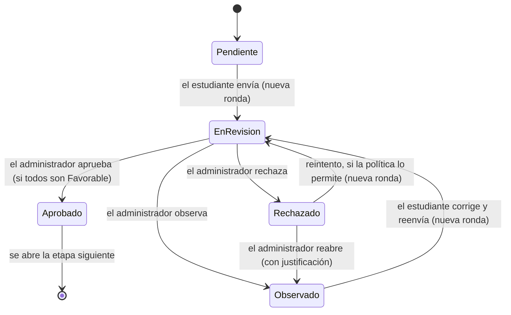

# Proceso de etapas de la tesis

Cómo avanza una tesis de grado en el sistema, qué decide cada actor y **qué se puede cambiar por configuración si el Product Owner cambia una regla**. Es la referencia funcional de la decisión [ADR-005](adr/ADR-005-politicas-de-etapa-y-rondas.md).

> **Estado.** Las reglas por defecto reflejan las respuestas del Product Owner del 2026-10-20. Lo que aún espera confirmación está marcado como **[por confirmar]**. Cuando se confirme o cambie, se ajusta la configuración y este documento.

## 1. Visión general

Una tesis recorre **7 etapas en orden**. Solo una está abierta a la vez; no se avanza a la siguiente hasta que la actual se aprueba.

| # | Etapa | Qué es |
|---|---|---|
| 1 | Inscripción del estudiante | El estudiante registra su tesis. |
| 2 | Propuesta | Presenta la propuesta (documento **obligatorio**). |
| 3 | Consejo | Trámite administrativo; no tiene actores propios en el sistema. |
| 4 | Evaluación | Evaluación de la tesis por los evaluadores. |
| 5 | Pasantía | Método de trabajo de grado parecido a las prácticas (documento **obligatorio**). |
| 6 | Artículo | Fuente de información para referenciar la propuesta. |
| 7 | Requisitos finales | Validación de que se cumple todo lo exigido. |

Cuando se aprueba la etapa 7, la tesis queda **Finalizada**.

## 2. Quién hace qué

| Actor | Puede |
|---|---|
| **Estudiante** | Registrar su tesis (una activa a la vez), subir documentos, enviar la etapa a revisión, ver su avance y los veredictos de la ronda actual. |
| **Evaluador** | Ver las etapas que le asignaron y emitir (o actualizar) su veredicto mientras la etapa está en revisión. |
| **Administrador** | Asignar evaluadores, decidir (aprobar, observar, rechazar), reabrir etapas, gestionar usuarios y consultar la auditoría. |

## 3. Estados de una etapa

Una etapa rechazada **sin reintento** deja la tesis **Rechazada** (definitivo), salvo que el administrador la reabra.

## 4. Resultados de una decisión

| Resultado | Significado | Efecto |
|---|---|---|
| **Aprobada** | La etapa cumple. | Se abre la siguiente (o la tesis finaliza tras la 7). Exige la regla de unanimidad (§6). |
| **Observada** | Hay correcciones puntuales. | La etapa vuelve al estudiante; corrige y reenvía **la misma etapa**. Justificación obligatoria. |
| **Rechazada** | La etapa no cumple. | Si la etapa admite reintento: vuelve al estudiante y la tesis **sigue en curso**. Si no: la tesis queda rechazada. Justificación obligatoria. |
| **Reabierta** | El administrador corrige una decisión previa. | Devuelve al estudiante una etapa rechazada. Justificación obligatoria. |

Las decisiones **no se pueden modificar ni borrar**: quedan como historial inmutable.

## 5. Rondas

Cada vez que el estudiante **envía** una etapa a revisión comienza una **ronda** (1, 2, 3…). Los veredictos y las decisiones pertenecen a una ronda. Al reenviar tras una observación o un rechazo, los evaluadores **vuelven a evaluar** la versión nueva; los veredictos anteriores se conservan como historial pero **no cuentan** para la ronda actual.

## 6. Evaluadores y unanimidad

- Cada etapa admite **hasta 3 evaluadores** activos.
- El evaluador emite un **veredicto** con concepto (*Favorable*, *Con observaciones*, *Desfavorable*) y comentarios. Puede actualizarlo mientras la etapa siga en revisión; cada cambio es una versión nueva.
- **Para aprobar**, todos los evaluadores activos de la etapa deben tener un veredicto *Favorable* en la ronda actual. Si falta alguno o hay uno que no es *Favorable*, el sistema **no permite aprobar** y lo explica.
- **Observar o rechazar** no tiene esa restricción: el administrador puede hacerlo en cualquier momento de la revisión.
- Una etapa **sin evaluadores asignados** la puede aprobar el administrador directamente (es el caso de un trámite como el Consejo).
- El administrador **siempre confirma**: el sistema nunca aprueba solo.

## 7. Rechazo: reintento o definitivo

| Etapa | ¿Se puede reintentar? |
|---|---|
| 1 Inscripción, 2 Propuesta, 3 Consejo, 4 Evaluación | **Sí** |
| 5 Pasantía, 6 Artículo | **No** (definitivo) |
| 7 Requisitos finales | **Sí** **[por confirmar]**: las respuestas del Product Owner difieren |

«Reintentar» significa que el estudiante vuelve a subir documentos y reenvía **la misma etapa**, sin perder la tesis y sin límite de intentos. Un estudiante cuya tesis queda rechazada puede registrar una nueva (una a la vez).

## 8. Reapertura

El administrador puede **reabrir** una etapa rechazada, incluso una definitiva, con una **justificación obligatoria**. Se registra como decisión inmutable (*Reabierta*), la tesis vuelve a estar en curso y la etapa queda observada para que el estudiante corrija y reenvíe. Existe para corregir errores sin intervenir la base de datos.

## 9. Visibilidad y notificaciones

- El estudiante ve en todo momento el estado de cada etapa y, **apenas se emiten**, los veredictos de la ronda actual con sus comentarios.
- Los evaluadores aparecen como «Evaluador 1, 2…» (anónimo) por defecto **[por confirmar]**. Es configurable.
- **Correos al estudiante:** cuando se emite o actualiza un veredicto, cuando el administrador decide y cuando se reabre una etapa. Los correos informan y enlazan al sistema; el detalle está en la aplicación.
- **Correos a los evaluadores:** cuando una etapa suya entra en una ronda nueva.

## 10. Configuración

Todo vive en `appsettings.json` o variables de entorno, sin recompilar. Si falta una clave se usa el valor por defecto de la tabla.

| Clave | Defecto | Qué controla |
|---|---|---|
| `Flujo:Etapas:<Etapa>:PermiteReintento` | `true` en 1, 2, 3, 4 y 7; `false` en Pasantia y Articulo | Si un rechazo permite corregir y reenviar. |
| `Flujo:Etapas:<Etapa>:MaxEvaluadores` | `3` | Tope de evaluadores activos. |
| `Flujo:Etapas:<Etapa>:ExigeUnanimidad` | `true` | Si aprobar exige que todos sean *Favorable*. |
| `Flujo:MostrarNombreEvaluador` | `false` | Si el estudiante ve el nombre del evaluador. |
| `Documentos:Requisitos:<Etapa>:<n>` | Propuesta → `Propuesta`; Pasantia → `Pasantía` | Categorías obligatorias para enviar la etapa. |

`<Etapa>` es `Estudiante`, `Propuesta`, `Consejo`, `Evaluacion`, `Pasantia`, `Articulo` o `RequisitosFinales`. En variables de entorno: `Flujo__Etapas__Pasantia__PermiteReintento=true`.

## 11. Si el Product Owner cambia de opinión

| Cambio | Qué se hace |
|---|---|
| «Pasantía sí se puede reintentar» | `Flujo__Etapas__Pasantia__PermiteReintento=true` |
| «Requisitos finales es definitivo» | `Flujo__Etapas__RequisitosFinales__PermiteReintento=false` |
| «Máximo 2 evaluadores en una etapa» | `Flujo__Etapas__<Etapa>__MaxEvaluadores=2` |
| «No exigir unanimidad en el Consejo» | `Flujo__Etapas__Consejo__ExigeUnanimidad=false` |
| «El estudiante debe ver el nombre del evaluador» | `Flujo__MostrarNombreEvaluador=true` |
| «Hace falta un documento más en una etapa» | `Documentos__Requisitos__<Etapa>__1=<Categoría>` |
| «Solo re-evalúan quienes observaron» | Cambio de código (regla de ronda); está aislado en un único punto del dominio |
| «Hay plazos por etapa» | Funcionalidad nueva (hoy no se manejan) |

## 12. Reglas que no cambian

- Una sola etapa abierta por tesis y se aprueban en orden (INV-1, INV-2).
- Solo se puede decidir sobre una etapa **en revisión**.
- Decisiones y registros de auditoría son **inmutables**.
- Solo el administrador decide; el sistema nunca aprueba por sí solo.
- Todo cambio de estado deja registro en la auditoría.
